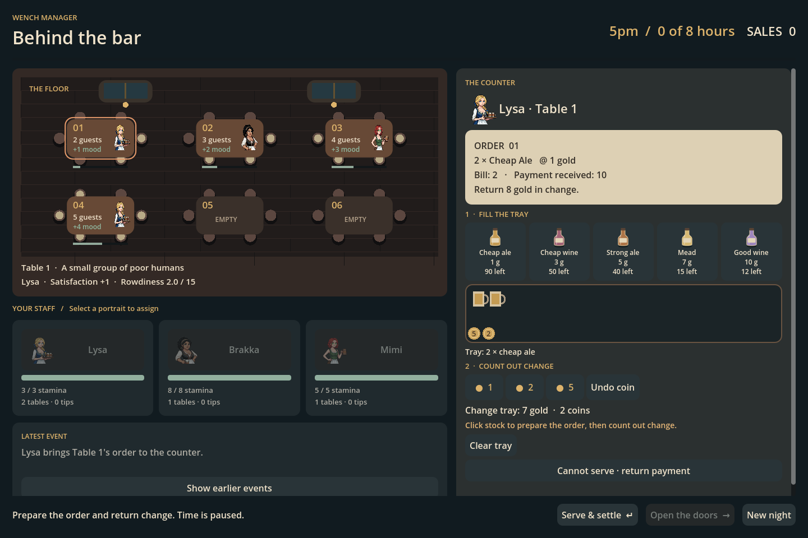

# Behind the bar — playable counter milestone

## What to play

Run the project normally (F5): `CounterMain.tscn` is now the main scene.
The original `Main.tscn` dashboard can still be run with F6 as a legacy comparison.
The reference viewport is 1440 × 960 and scales with the window.

1. Open the doors. Each new group highlights its table. Click a staff portrait to assign it.
2. During service, the assigned server appears at the counter with an order and payment.
3. Click bottle controls to place individual servings in the tray. Click a mug to return it.
4. Count out 1-, 2- or 5-gold coins. The ticket shows the amount due and change required.
5. **Serve & settle** commits the transaction and resumes service. Wrong items or change
   leave the order open with corrective feedback and spend nothing.
6. Resolve rowdy-table choices, then arrange staffing and advance the next hour.
7. Close at 1am and review results. New Night asks before discarding an active night.

Keyboard: **1–5** add the corresponding product; **Q/W/E** add 1/2/5 gold;
**Backspace** removes the latest coin; **Enter** serves; **Space** advances an idle hour.
Buttons also support normal keyboard focus. Click tables to inspect occupancy,
server, satisfaction and rowdiness; between hours select a staff portrait to reassign.

The floor's small bars represent rowdiness toward the 15-point crisis threshold.
Staff bars show current stamina. Highlighted tables need input or have the active order.
The latest description stays visible and earlier events are available on demand.

## Transaction rules

Counter service is opt-in on `Simulation.counter_service_enabled`; the new scene enables
it. The legacy automated path stays available for comparisons and regression checks.
`AWAITING_ORDER` is a genuine simulation phase: advancing time, another table, or a
choice cannot bypass a pending order. Order IDs include night, hour and unique visit ID.

Demand uses the existing hourly quantity and price rules. Payment is an abstract
single-currency amount rounded up to the next multiple of five, plus five, so players
can practice making change. Coin denominations are currently unlimited; this is not
an opening-float or finite-denomination economy yet.

The tray is a reversible preview. Only accepted settlement deducts stock, credits sales,
updates consumption and satisfaction, resolves the table's event, and writes a receipt.
Each receipt records order/visit ID, quantity, tender, change, sale and whether declined.
Duplicate and stale submissions cannot post twice. Receipts reset with the night.

If stock is short, the ticket requests the available amount and refunds the remainder.
Zero stock can be settled with a full refund. **Cannot serve** declines any order,
returns all payment, spends no inventory, and applies the existing failed-service penalty.
Exact-stock fulfillment earns the normal +1 service satisfaction. The old free-round
message now reports actual deltas, and using its final stock item is no longer penalized
when the promised round was completely supplied. Free rounds remain direct table
interventions, not a second manually prepared order.

No real-time countdown: simulation time pauses for every assignment, order and decision.
The change amount is deliberately shown in this first version. This tests handling
objects and transactions before adding arithmetic difficulty or pressure.

## Validation

Godot 4.5 stable: 735 existing simulation checks, 74 legacy UI checks, and 50 new counter
checks pass (859 total). New coverage includes wrong/negative/noninteger quantities,
wrong change, duplicate/stale orders, stock conservation, receipts, shortages, declines,
restart, scene button signals, and ten complete seeded counter nights.

The real viewport was rendered using Godot's OpenGL compatibility renderer and inspected.
The serving action was moved into the fixed footer after the first layout check revealed
it below the fold. `tests/capture_counter.gd` reproduces a populated demonstration view
with staged items; it is a visual fixture, not a naturally played save game.

Native exports have not been rebuilt for this milestone. Run from the Godot editor.

## Next decisions, after a playtest

The broader direction is a keeper serving at the bar in an occupied city: orders,
physical transfers of goods and money, staff loyalties and resistance funding. This
build keeps the current fantasy roster and establishes the counter transaction seam.
It does not choose a historical country or implement faction currencies yet.

Suggested next bounded build: finite till inventory, a second fictional currency,
and a night ledger. Decide denomination/exchange rules before introducing resistance
transactions. Then consider order patience, staff mistakes, loyalty consequences and
multi-night persistence. Optional LLM narration should receive already-resolved events;
it must not determine payments or mutate the economic ledger.

## Preview

